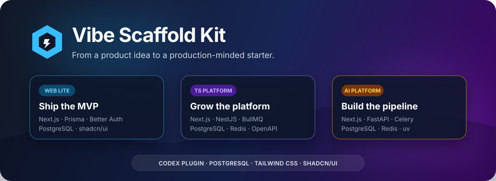
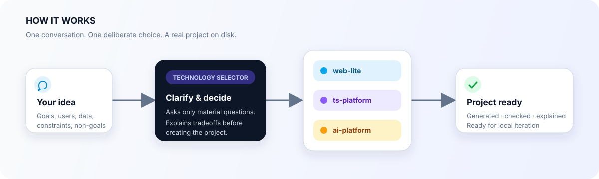

<p align="center">
  
</p>

<p align="center">
  <a href="LICENSE"></a>
  
  
  
  
</p>

<p align="center">
  <strong>别再从一堆技术名词开始项目。先讲清楚要做什么，再让插件替你选择合适的工程底座。</strong>
</p>

`Vibe Scaffold Kit` 是一个可安装的 Codex Plugin，也是一套可以独立运行的项目生成器。它内置 `technology-selector` Skill，会先理解你的产品目标、用户、数据、后台任务、AI/爬虫需求和部署约束，再从三套脚手架中选择合适的一套并创建项目。

它不是只给出一份“技术栈建议”，而是会真正生成可以继续开发的工程文件。

## 它能帮你做什么？

一句话描述想法即可开始，例如：

```text
使用 $technology-selector，我想做一个支持多人协作、可以给 GitHub 项目点赞和收藏的在线服务。
```

插件会完成下面这条链路：

<p align="center">
  
</p>

具体来说，它会：

- 追问真正会影响架构的细节，而不是发一张机械的长问卷；
- 判断项目更适合轻量全栈、TypeScript 平台，还是 Python AI/数据架构；
- 使用插件内置模板创建完整项目目录；
- 检查项目结构，并在依赖可用时运行 `check` 和 `build`；
- 告诉你实际采用了哪些前后端、数据库、认证、队列和测试技术；
- 解释为什么选这套方案，以及另外两套为什么不合适。

> 插件默认不会替你启动 Docker、执行数据库 migration、部署线上环境或推送新项目。只有你明确要求时，它才会继续做这些会改变环境状态的操作。

## 三套脚手架，不做万能大杂烩

所有模板都使用 PostgreSQL、Tailwind CSS 4 和 shadcn/ui，但服务边界会根据项目复杂度变化。

| 模板 | 适合什么项目 | 主要技术栈 | 默认不包含 |
|---|---|---|---|
| `web-lite` | MVP、会员系统、内容站、内部工具、简单 SaaS | Next.js App Router、Prisma、Better Auth、PostgreSQL、Vitest、Playwright | Redis、独立 Worker、独立 API 服务 |
| `ts-platform` | 多客户端、复杂权限、支付、公开 API、定时任务 | Turborepo、Next.js、NestJS/Fastify、Prisma、PostgreSQL、Redis、BullMQ | Python 数据生态、微服务、Kubernetes |
| `ai-platform` | LLM、RAG、爬虫、量化、NLP、文档处理、长任务 | Next.js、FastAPI、Pydantic、SQLAlchemy、Alembic、PostgreSQL、Redis、Celery、uv | 为普通 CRUD 强行增加 Python 服务 |

选择原则很简单：

1. Python AI、爬虫或数据处理是核心，选择 `ai-platform`。
2. 否则，需要独立 API、多个客户端或可靠后台任务，选择 `ts-platform`。
3. 其余情况选择更轻、更容易维护的 `web-lite`。

如果只是调用一次外部大模型 API，插件不会因为需求里出现“AI”两个字就直接上 Python；如果只是验证一个小想法，也不会一上来生成复杂平台架构。

更完整的取舍见 [技术决策说明](docs/DECISIONS.md)。

## 安装插件

### 前置环境

- [Codex CLI 或 Codex 桌面应用](https://developers.openai.com/plugins/build/plugins)
- Node.js 24
- pnpm 11
- Docker Desktop：本地运行 PostgreSQL/Redis 时需要
- Python 3.11+ 和 uv：只在创建、运行 `ai-platform` 时需要

### 1. 添加 GitHub Marketplace

```bash
codex plugin marketplace add YuanYCoding/vibe-scaffold-kit --ref main
```

### 2. 安装插件

命令行安装：

```bash
codex plugin add vibe-scaffold-kit@vibe-scaffold-kit
```

也可以打开 Codex/ChatGPT 桌面应用的 **Plugins Directory**，选择 **Vibe Scaffold Kit** 来源后点击安装。

### 3. 开始使用

建议安装后新建一个任务，让 Codex 在干净上下文中加载 Skill，然后直接描述项目：

```text
使用 $technology-selector，我想做一个 AI 和爬虫结合的竞品监控平台。
```

也可以给出更多边界：

```text
使用 $technology-selector 创建 customer-portal。

这是一个给企业客户使用的 SaaS，需要邮箱登录、管理员和普通成员角色、
Stripe 订阅、公开 REST API，以及每天生成账单报表。预计首年 5 万用户，
部署在单台云服务器上，项目生成到 ~/Code/customer-portal。
```

信息还不够时，插件会继续询问；信息足够后，它会总结理解、选择模板、创建工程并完成验证。

## 不安装插件，也能直接生成项目

如果你只想使用三套模板：

```bash
git clone https://github.com/YuanYCoding/vibe-scaffold-kit.git
cd vibe-scaffold-kit
pnpm install --frozen-lockfile
```

选择一种模板：

```bash
# MVP、内容产品、简单 SaaS
pnpm scaffold web-lite my-product

# 独立 API、多客户端、后台任务
pnpm scaffold ts-platform my-platform

# AI、爬虫、RAG、量化和数据处理
pnpm scaffold ai-platform my-ai-product
```

默认行为包括：

- 安装项目依赖；
- 从示例创建本地 `.env`；
- 生成高熵开发密钥；
- 初始化 Git 并暂存生成文件；
- 在适用模板中生成初始数据库客户端。

常用选项：

```bash
# 只生成文件，不安装依赖，也不初始化 Git
pnpm scaffold web-lite my-product --no-install --no-git

# 输出到指定父目录
pnpm scaffold ai-platform research-agent --output ~/Code
```

项目名必须使用小写 kebab-case，例如 `my-product`、`ai-research-lab`。

## 生成之后怎么跑？

进入新项目后，先阅读其中的 `README.md` 和 `docs/ARCHITECTURE.md`。常见启动流程是：

```bash
cd <项目目录>
docker compose up -d postgres
pnpm db:deploy
pnpm dev
```

`ts-platform` 和 `ai-platform` 同时需要 Redis：

```bash
docker compose up -d postgres redis
```

三套模板遵守同一组工程约定：

- PostgreSQL 保存业务事实；migration 进入 Git，数据库数据和密钥不进入 Git；
- 外部输入使用 Zod 或 Pydantic 校验；
- Redis 只承担缓存、队列和协调职责；
- 每个模板都包含健康检查、测试、Docker Compose、GitHub Actions 和项目级 `AGENTS.md`；
- 优先模块化单体，不为想象中的规模提前引入微服务、Kafka 或 Kubernetes。

## 更新插件

```bash
codex plugin marketplace upgrade vibe-scaffold-kit
codex plugin add vibe-scaffold-kit@vibe-scaffold-kit
```

更新后新建一个 Codex 任务，以确保加载最新的 Skill 和模板。

## 仓库结构

```text
vibe-scaffold-kit/
├── plugin.json                         # 便携式 Agent Plugin 清单
├── .codex-plugin/plugin.json           # Codex 兼容清单与展示信息
├── .agents/plugins/marketplace.json    # GitHub Marketplace 入口
├── skills/technology-selector/         # 需求澄清与技术选型 Skill
├── templates/
│   ├── web-lite/
│   ├── ts-platform/
│   └── ai-platform/
├── create.mjs                          # 项目生成器
├── scripts/                            # 验证与烟雾测试
└── docs/DECISIONS.md                   # 技术决策记录
```

Skill 与三个模板放在同一个插件中，使用相对路径定位。仓库被克隆到任何目录，或者被 Codex 安装到插件缓存后，都不依赖作者电脑上的路径。

## 开发与验证

```bash
# 检查生成器、模板契约、Plugin 清单和 Skill 资源
pnpm check

# 在临时目录生成三套项目并执行检查
./scripts/smoke-all.sh

# Docker 可用时验证数据库 migration
./scripts/smoke-databases.sh

# 验证模板提供的生产镜像
./scripts/smoke-images.sh
```

## 关于生产部署

脚手架负责可复现构建、数据库 migration 和 CI，但不会假装存在一份适合所有云平台的部署文件。

`web-lite` 已带独立 Next.js 镜像，`ai-platform` 已带 FastAPI 镜像；`ts-platform` 和 AI 前端应在确定使用单机 Compose、云容器还是托管平台后，再补目标化发布流程。这样生成的项目更诚实，也更容易长期维护。

## 贡献

欢迎提交 Issue 或 Pull Request：

- 新能力应优先改进现有三套模板，不轻易增加第四套；
- 不把真实 `.env`、数据库数据、凭据或生成项目提交进仓库；
- 修改模板后至少运行 `pnpm check`，条件允许时再运行对应 smoke test；
- 技术选型规则变化时，同时更新 `skills/technology-selector/references/scaffold-catalog.md`。

## License

[MIT](LICENSE) © 2026 YuanYCoding

---

<details>
<summary><strong>English summary</strong></summary>

Vibe Scaffold Kit is a Codex plugin and standalone generator that clarifies product requirements, selects one of three bundled production-minded templates, creates the project, verifies it, and explains the stack tradeoffs. All templates use PostgreSQL, Tailwind CSS, and shadcn/ui. See the installation and prompt examples above to get started.

</details>
